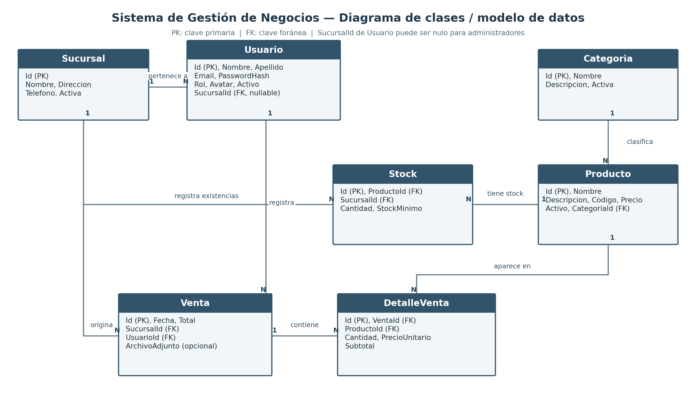

# Backend — Sistema de Gestión de Negocios

API RESTful desarrollada con **ASP.NET Core .NET 8**, **Entity Framework Core 8** y **MySQL 8.0**, diseñada para la administración integral, inventario multi-sucursal y control operativo de comercios.

---

## 1. Descripción General y Problemática

### Problemática
Los comercios con múltiples puntos de venta físicos sufren frecuentemente desfasajes de stock, registros manuales descentralizados, falta de trazabilidad en las ventas por empleado y pérdida del histórico de precios cuando los productos aumentan su valor en góndola.

### Solución Implementada
Esta Web API centraliza las reglas de negocio, la seguridad y el almacenamiento de datos bajo una arquitectura desacoplada basada en capas (`Controller -> Service -> DbContext`):
- **Gestión Multi-Sucursal:** Existencias independientes de productos por cada local con alertas de stock mínimo y agotado.
- **Ventas con Integridad Transaccional:** Descuento atómico de stock al confirmar la venta, persistencia del precio unitario histórico en los detalles, posibilidad de adjuntar comprobantes digitales (PDF/imágenes) y anulación con restitución automática de existencias.
- **Seguridad Robusta:** Autenticación y autorización basada en claims y roles (`Administrador` y `Empleado`) mediante JSON Web Tokens (JWT) y cifrado de claves con `PasswordHasher<Usuario>` (ASP.NET Core Identity V3).

---

## 2. 📋 Matriz de Evidencias de Requerimientos Mínimos

A continuación se detalla el cumplimiento estricto y la ubicación en el código de cada requerimiento solicitado por la cátedra:

| # | Requerimiento Mínimo | Estado | Enlace al Código / Controladores | Evidencia Técnica / Ubicación |
|---|---|:---:|---|---|
| **1** | **4 Tablas y Relación 1:N** | ✅ Cumplido | [ApplicationDbContext.cs](https://github.com/EsTeBaN22001/gestion-negocios-backend/blob/master/src/GestionNegocios.Api/Data/ApplicationDbContext.cs)<br>[Models/](https://github.com/EsTeBaN22001/gestion-negocios-backend/tree/master/src/GestionNegocios.Api/Models) | **7 entidades relacionadas:** `Sucursales`, `Categorias`, `Productos`, `Usuarios`, `Stocks`, `Ventas` y `DetallesVenta`.<br>Diagrama DER adjunto en [docs/der.png](docs/der.png) y documento de narrativa en [docs/Narrativa del Proyecto - Sistema de Gestion de Negocios.docx](docs/Narrativa%20del%20Proyecto%20-%20Sistema%20de%20Gestion%20de%20Negocios.docx). |
| **2** | **Login, Roles y Avatar** | ✅ Cumplido | [AuthController.cs](https://github.com/EsTeBaN22001/gestion-negocios-backend/blob/master/src/GestionNegocios.Api/Controllers/AuthController.cs)<br>[UsuarioService.cs](https://github.com/EsTeBaN22001/gestion-negocios-backend/blob/master/src/GestionNegocios.Api/Services/UsuarioService.cs) | Generación de token JWT en `/api/auth/login`, control de roles (`Administrador` y `Empleado`) con políticas `[Authorize(Roles = "...")]`, endpoint `/api/auth/me`, y subida de imagen de avatar de perfil en `/api/auth/me/avatar`. |
| **3** | **Manejo de Archivos (Extra)** | ✅ Cumplido | [FileStorageService.cs](https://github.com/EsTeBaN22001/gestion-negocios-backend/blob/master/src/GestionNegocios.Api/Services/FileStorageService.cs)<br>[VentasController.cs](https://github.com/EsTeBaN22001/gestion-negocios-backend/blob/master/src/GestionNegocios.Api/Controllers/VentasController.cs) | Subida física de comprobantes/facturas asociadas a ventas (`POST /api/ventas/{id}/comprobante`), validación de extensión MIME, tamaño máximo y descarga protegida (`GET /api/ventas/{id}/comprobante`). Almacenamiento en `wwwroot/uploads`. |
| **4** | **ABM / Controladores RESTful** | ✅ Cumplido | [ProductosController.cs](https://github.com/EsTeBaN22001/gestion-negocios-backend/blob/master/src/GestionNegocios.Api/Controllers/ProductosController.cs)<br>[SucursalesController.cs](https://github.com/EsTeBaN22001/gestion-negocios-backend/blob/master/src/GestionNegocios.Api/Controllers/SucursalesController.cs)<br>[CategoriasController.cs](https://github.com/EsTeBaN22001/gestion-negocios-backend/blob/master/src/GestionNegocios.Api/Controllers/CategoriasController.cs)<br>[UsuariosController.cs](https://github.com/EsTeBaN22001/gestion-negocios-backend/blob/master/src/GestionNegocios.Api/Controllers/UsuariosController.cs) | Operaciones CRUD completas utilizando estándares HTTP (`GET`, `POST`, `PUT`, `DELETE` lógico/físico), mapeo de DTOs con validaciones de unicidad y reglas de negocio. |
| **5** | **Paginado por Servidor** | ✅ Cumplido | [PagedResultDto.cs](https://github.com/EsTeBaN22001/gestion-negocios-backend/blob/master/src/GestionNegocios.Api/DTOs/PagedResultDto.cs)<br>[ProductoService.cs](https://github.com/EsTeBaN22001/gestion-negocios-backend/blob/master/src/GestionNegocios.Api/Services/ProductoService.cs#L45)<br>[SucursalService.cs](https://github.com/EsTeBaN22001/gestion-negocios-backend/blob/master/src/GestionNegocios.Api/Services/SucursalService.cs) | Paginación en servidor con consultas LINQ `.Skip((page - 1) * pageSize).Take(pageSize)`. Retorna DTO genérico con metadata: `PageNumber`, `PageSize`, `TotalItems`, `TotalPages`. |
| **6** | **Selección Asíncrona / Búsqueda** | ✅ Cumplido | [ProductoService.cs](https://github.com/EsTeBaN22001/gestion-negocios-backend/blob/master/src/GestionNegocios.Api/Services/ProductoService.cs)<br>[StockService.cs](https://github.com/EsTeBaN22001/gestion-negocios-backend/blob/master/src/GestionNegocios.Api/Services/StockService.cs) | Filtros de búsqueda asíncronos (`searchTerm`, `categoriaId`, `sucursalId`, `soloActivos`) procesados eficientemente en motor de base de datos MySQL con `EF.Functions.Like` y LINQ asíncrono. |
| **7** | **Web API + JWT** | ✅ Cumplido | [Program.cs](https://github.com/EsTeBaN22001/gestion-negocios-backend/blob/master/src/GestionNegocios.Api/Program.cs)<br>[AuthController.cs](https://github.com/EsTeBaN22001/gestion-negocios-backend/blob/master/src/GestionNegocios.Api/Controllers/AuthController.cs) | Configuración de `JwtBearerDefaults`, emisión de tokens firmados HMAC-SHA256 y colección Postman completa incluida en [docs/postman/](docs/postman/gestion_negocios.postman_collection.json) con script de token automático. |

---

## 3. Modelo de Datos y DER

El modelo de datos contiene 7 entidades principales diseñadas para reflejar fielmente la operativa comercial:



1. **Sucursales:** Puntos de venta físicos del comercio.
2. **Categorías:** Clasificación jerárquica con nombre único.
3. **Productos:** Catálogo de artículos con código único, precio actual y categoría.
4. **Usuarios:** Personal administrativo y operativo con roles (`Administrador` o `Empleado`) y avatar.
5. **Stocks:** Tabla intermedia Producto-Sucursal con `UNIQUE(ProductoId, SucursalId)`, cantidad física y umbral mínimo.
6. **Ventas:** Encabezado de transacciones con fecha, total, sucursal, empleado emisor y comprobante adjunto.
7. **DetallesVenta:** Renglones de venta con producto, cantidad, subtotal y congelamiento del precio histórico.

---

## 4. Requisitos y Entorno Local

- **.NET 8.0 SDK** (o superior)
- **MySQL 8.0+** o **MariaDB 10.4+** (mediante Laragon, XAMPP, HeidiSQL, Docker o servicio MySQL local)
- Gestor de base de datos a elección: phpMyAdmin, HeidiSQL, DBeaver, o MySQL Workbench

---

## 5. Puesta en Marcha Paso a Paso (Sin Docker)

### Paso 1: Configurar la Base de Datos

Tienes dos opciones totalmente compatibles:

#### Opción A (Recomendada - Carga Directa SQL):
Abre tu gestor de base de datos (por ejemplo, el phpMyAdmin o HeidiSQL de Laragon/XAMPP) y ejecuta el script completo:
📁 **`database/gestion_negocios.sql`**

Este script crea automáticamente la base de datos `gestion_negocios`, todas las tablas, relaciones, la tabla de migraciones de EF Core, y un conjunto completo de datos iniciales (sucursales, categorías, productos, usuarios con claves cifradas, stocks y ventas).

#### Opción B (Mediante migraciones de Entity Framework Core):
Si prefieres que EF Core genere la base de datos a partir del código:
```bash
dotnet ef database update --project src/GestionNegocios.Api
```

---

### Paso 2: Configurar la Cadena de Conexión

Edita el archivo `src/GestionNegocios.Api/appsettings.Development.json` (o `appsettings.json`) según tus credenciales de MySQL:

```json
{
  "ConnectionStrings": {
    "DefaultConnection": "Server=localhost;Port=3306;Database=gestion_negocios;User=root;Password=;CharSet=utf8mb4;"
  }
}
```
*(Para Laragon o XAMPP, el usuario predeterminado suele ser `root` y la contraseña suele estar vacía `Password=;`)*.

---

### Paso 3: Compilar y Ejecutar

Desde la carpeta raíz del repositorio `backend`:

```bash
# 1. Restaurar paquetes NuGet
dotnet restore

# 2. Compilar la solución
dotnet build

# 3. Iniciar la Web API
dotnet run --project src/GestionNegocios.Api
```

La API quedará escuchando en:
- **API Base:** `http://localhost:5000`
- **Documentación Swagger UI interactiva:** `http://localhost:5000/swagger`
- **Health Checks:**
  - `http://localhost:5000/api/health` (Estado de la API)
  - `http://localhost:5000/api/health/db` (Conectividad con MySQL)

---

## 6. Credenciales de Prueba (Seed Inicial)

| Rol | Correo Electrónico | Contraseña | Alcance / Permisos |
|---|---|---|---|
| **Administrador** | `admin@gestionnegocios.local` | `Admin123*` | Acceso global a todas las sucursales, ABM de productos, categorías, usuarios y ajuste manual de stock. |
| **Empleado** | `empleado@gestionnegocios.local` | `Empleado123*` | Aislado a Sucursal Centro (Id 1). Registro de ventas, consulta de stock propio y comprobantes. |
| **Empleado 2** | `ana.norte@gestionnegocios.local` | `Empleado123*` | Asignado a Sucursal Norte (Id 2). |

---

## 7. Pruebas Automatizadas

La solución cuenta con una suite completa de **57 pruebas unitarias** que validan controladores, servicios, generación de tokens JWT, almacenamiento de archivos y reglas de negocio:

```bash
dotnet test
```

Resultado esperado:
```text
Correctas! - Con error: 0, Superado: 57, Omitido: 0, Total: 57
```

---

## 8. Colección Postman

En la carpeta [`docs/postman/`](docs/postman/gestion_negocios.postman_collection.json) se incluye el archivo:
- **`gestion_negocios.postman_collection.json`**

Al importarlo en Postman:
1. Al ejecutar la petición `02 - Autenticación (JWT) > Login Administrador`, el script guarda automáticamente el token en la variable `{{token}}`.
2. Todas las peticiones subsecuentes envían automáticamente el encabezado `Authorization: Bearer {{token}}`.
