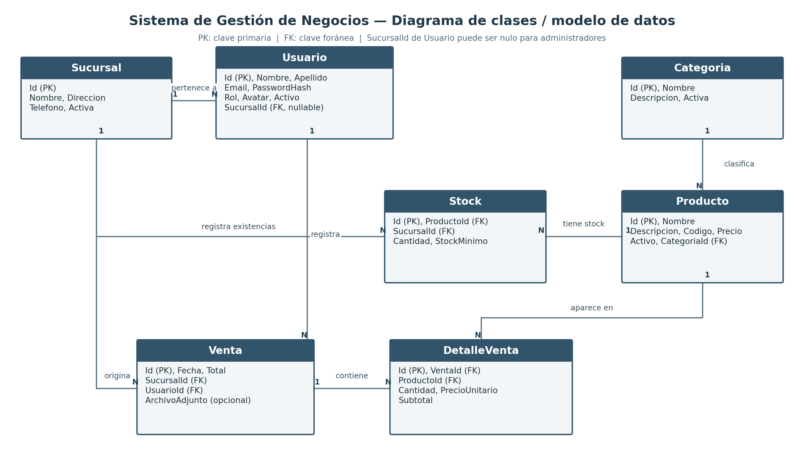

# Sistema de Gestión de Negocios
## Definición de temática, alcance funcional y modelo de datos inicial

El objetivo de este documento es definir la temática, el alcance funcional y el modelo de datos inicial del **Proyecto Integrador Final**. Esta instancia permite validar que la propuesta cumpla con la complejidad técnica requerida antes de comenzar la etapa intensiva de desarrollo.

---

## 1. Narrativa del Proyecto y Descripción del Problema

### Datos del grupo
| Apellido y nombre | Email |
|---|---|
| **Redón, Esteban** | esteban1.redon2@gmail.com |

### Título / nombre del proyecto y temática elegida
**Sistema de Gestión de Negocios.** La temática corresponde a la gestión administrativa y operativa de un comercio con una o más sucursales, incluyendo la administración de productos, categorías, existencias y ventas.

### Descripción de la problemática
Los comercios que trabajan con distintas sucursales necesitan mantener organizada y actualizada la información de sus productos, el inventario disponible en cada local y las operaciones de venta realizadas por sus empleados. Cuando estos procesos se administran mediante registros manuales, planillas aisladas o herramientas que no comparten información, pueden aparecer inconsistencias en las cantidades disponibles, dificultades para consultar el historial de ventas y falta de control sobre las operaciones de cada sucursal. También se vuelve más complejo determinar qué usuario realizó una venta y qué productos fueron incluidos.

### Propuesta de solución
Se propone desarrollar una aplicación web centralizada que permita administrar la información operativa del negocio desde una única plataforma. El sistema cuenta con usuarios y roles para controlar el acceso, sucursales, categorías y productos. Cada producto mantiene existencias independientes por sucursal, lo que permite consultar y controlar el inventario de cada local.

El módulo de ventas permite registrar operaciones asociadas a una sucursal y al usuario que las realiza, incorporando uno o varios productos mediante sus respectivos detalles. Al confirmar una venta, el sistema verifica que exista stock suficiente y actualiza las cantidades disponibles. Cada detalle conserva el precio unitario aplicado al momento de la operación, de modo que el historial no se vea alterado ante futuros cambios de precio.

La solución se desarrolla como una aplicación web con backend en **ASP.NET Core .NET 8**, **Entity Framework Core** y **MySQL**, y un frontend en **Angular 18**. La API centraliza las validaciones y reglas de negocio, mientras que la interfaz permite a los usuarios operar el sistema desde un navegador. La autenticación se realiza mediante tokens **JWT** y los permisos se controlan según el rol del usuario.

### Alcance funcional inicial
- Autenticación de usuarios y control de acceso según roles (`Administrador` y `Empleado`).
- Administración de sucursales, categorías y productos.
- Registro y consulta de existencias por producto y sucursal.
- Registro de ventas con sus respectivos detalles y comprobantes adjuntos opcionales.
- Validación de disponibilidad y actualización del stock al confirmar una venta.
- Asociación de cada venta con el usuario y la sucursal correspondientes.
- Conservación del precio histórico de cada producto vendido.
- Anulación de ventas con restitución automática de existencias al inventario.

---

## 2. Modelo de Datos y Diagrama Entidad-Relación (DER)

El modelo de datos se organiza en **siete entidades principales**. Las claves primarias identifican cada registro y las claves foráneas permiten relacionar la información entre sucursales, usuarios, productos, existencias y ventas.

### Diagrama de Clases / Modelo de Datos (DER)

### Listado y descripción de entidades

| Entidad | Descripción |
|---|---|
| **Usuario** | Representa a las personas que utilizan el sistema. Almacena datos personales, email, hash de contraseña, rol, estado y, cuando corresponde, la sucursal a la que pertenece. El usuario administrador puede no estar asociado a una sucursal (alcance global). |
| **Sucursal** | Representa cada local o unidad operativa del negocio. Contiene nombre, dirección, teléfono y estado de actividad. |
| **Categoria** | Permite clasificar los productos para facilitar su organización y consulta. Incluye nombre, descripción y estado. |
| **Producto** | Almacena los datos generales de cada artículo comercializado: nombre, descripción, código único, precio, estado y categoría. |
| **Stock** | Registra la cantidad disponible y el stock mínimo de un producto en una sucursal determinada. Vincula Producto y Sucursal mediante clave única compuesta; no existe más de un registro para la misma combinación. |
| **Venta** | Representa una operación comercial. Registra fecha, total, sucursal, usuario responsable y, opcionalmente, la referencia a un archivo adjunto (comprobante o factura). |
| **DetalleVenta** | Representa cada producto incluido en una venta. Registra cantidad, precio unitario aplicado y subtotal, conservando el precio histórico de la operación. |

### Descripción de relaciones
- **Sucursal – Usuario (1:N):** una sucursal puede tener varios usuarios asociados; cada usuario operativo pertenece a una sucursal. La asociación es nula (`null`) para usuarios administradores globales.
- **Sucursal – Stock (1:N):** una sucursal mantiene múltiples registros de stock, uno por cada producto que comercializa.
- **Sucursal – Venta (1:N):** una sucursal puede registrar muchas ventas; cada venta queda asociada a la sucursal donde se realizó.
- **Categoria – Producto (1:N):** una categoría agrupa varios productos y cada producto pertenece a una categoría.
- **Producto – Stock (1:N):** un producto puede tener existencias registradas en distintas sucursales. Stock resuelve esta relación y permite guardar cantidades independientes.
- **Usuario – Venta (1:N):** un usuario puede registrar múltiples ventas; cada venta identifica al usuario responsable.
- **Venta – DetalleVenta (1:N):** una venta contiene uno o varios detalles, que representan los productos y cantidades vendidos. Al eliminar o anular, se mantiene la integridad referencial.
- **Producto – DetalleVenta (1:N):** un producto puede aparecer en muchos detalles de venta, conservando en cada uno la cantidad y el precio aplicado.

### Reglas de negocio relevantes para el modelo
1. La combinación **Producto–Sucursal** es única en `Stock`, evitando duplicar el inventario de un mismo producto dentro de una sucursal.
2. El stock no puede quedar en valores negativos.
3. Una venta debe contener al menos un detalle.
4. No se puede confirmar una venta si no existe disponibilidad suficiente de los productos solicitados en la sucursal correspondiente.
5. Al confirmar una venta, se descuenta del stock físico la cantidad solicitada.
6. El precio unitario se conserva en `DetalleVenta` para garantizar que cambios futuros de listas de precios no modifiquen los balances históricos.
7. Al anular una venta previamente confirmada, se restituye automáticamente el stock a la sucursal correspondiente.
